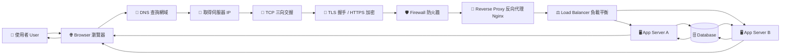
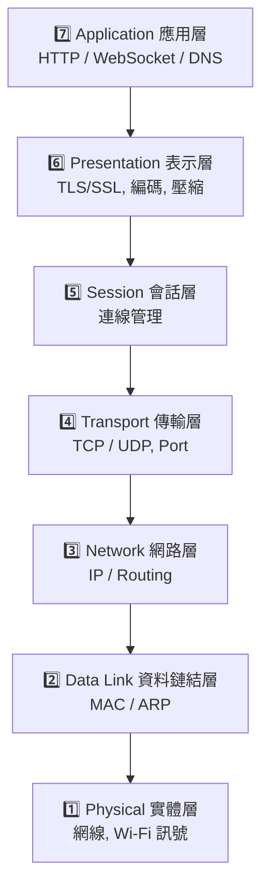
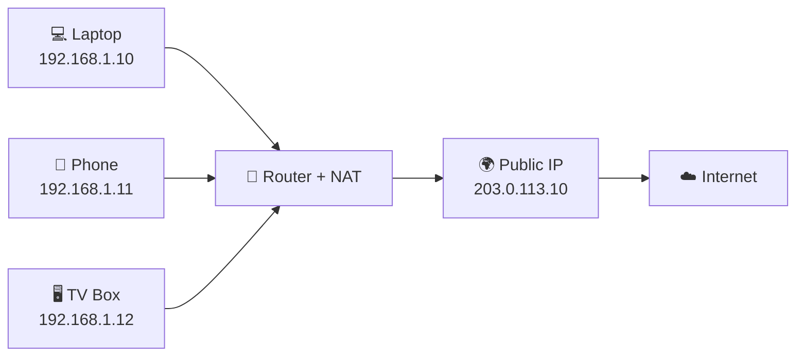
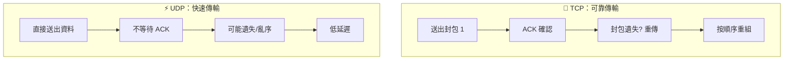
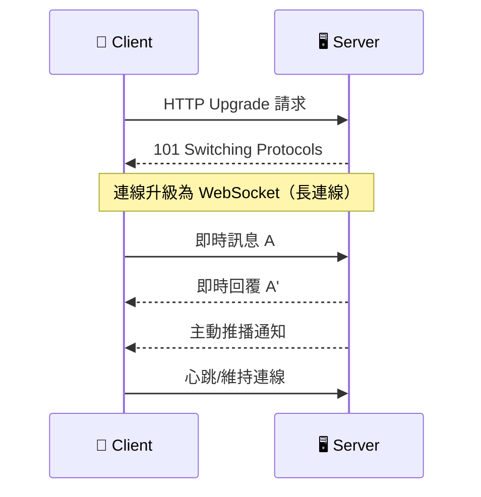
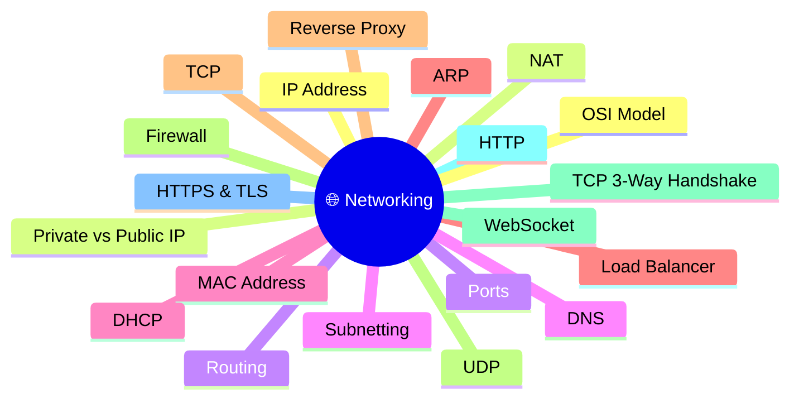

# 網路概念可視化流程圖（可匯出）

> 使用方式：
> 1. 複製整份內容到支援 Mermaid 的編輯器  
> 2. 顯示圖後，選擇 Export / Download（PNG 或 SVG）

---

## 1) 網頁請求全流程（從輸入網址到資料庫）

---

## 2) OSI 7 層對照（由上到下）

---

## 3) 家用網路：Private IP 經 NAT 上網

---

## 4) TCP vs UDP（可靠性 vs 速度）

---

## 5) WebSocket 即時通訊流程

---

## 6) 20 個概念關聯總圖（學習地圖）

---

## 匯出建議（PNG/SVG）

- **Mermaid Live Editor**：貼上後右上角可直接下載 PNG / SVG  
- **diagrams.net (draw.io)**：可重畫後匯出高解析圖  
- **Obsidian / Typora / VS Code Mermaid Preview**：可截圖或外掛匯出  
- **GitHub**：可渲染 Mermaid（若需下載建議用 Live Editor）

---

## 檔名建議

- `networking-visual-guide.md`
- `20-networking-concepts-flowcharts.md`